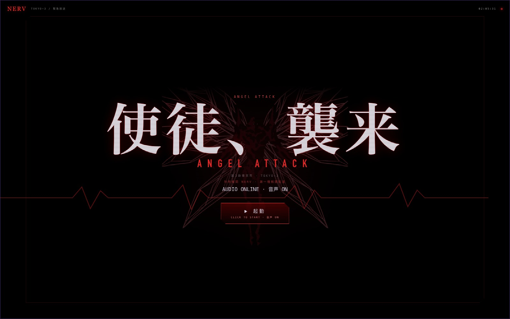
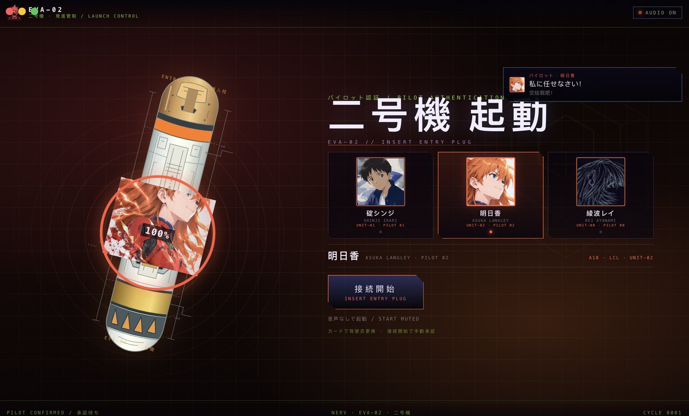
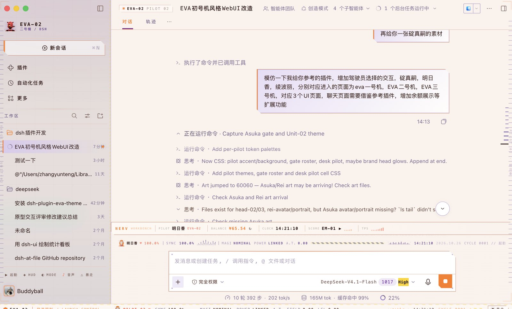
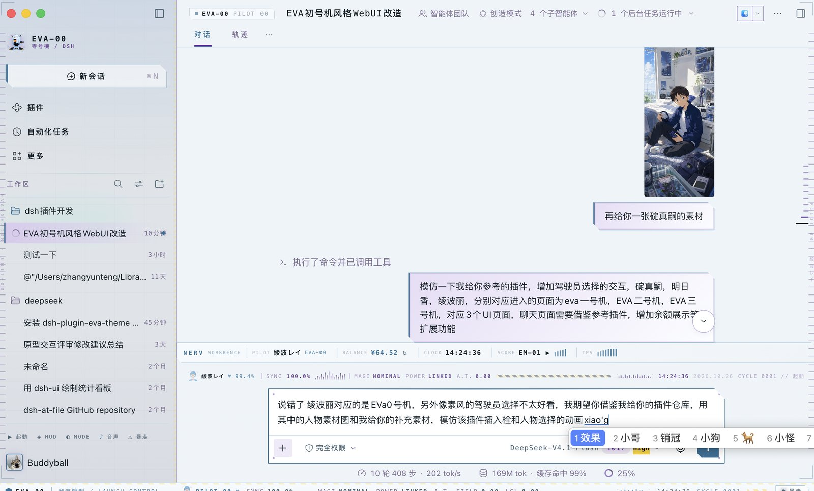
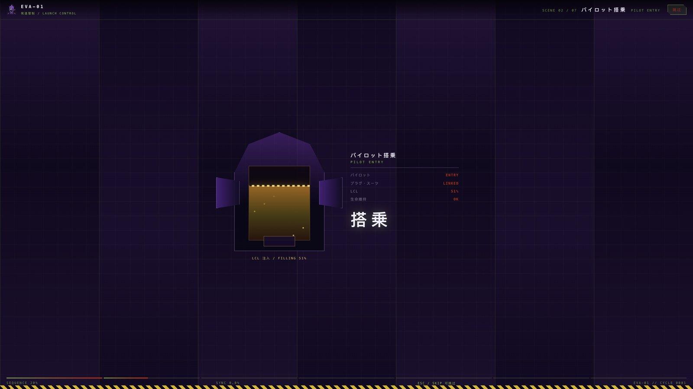
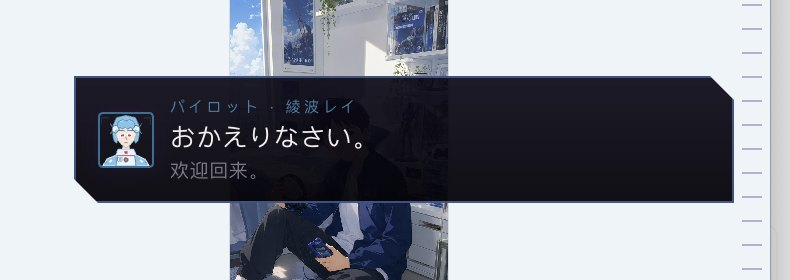
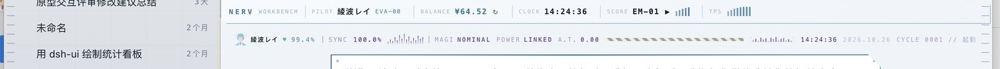
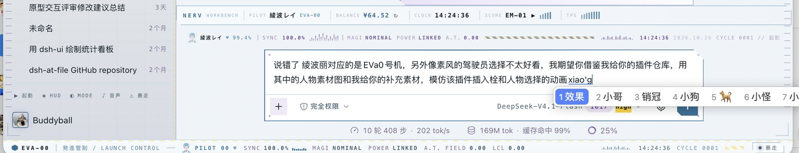
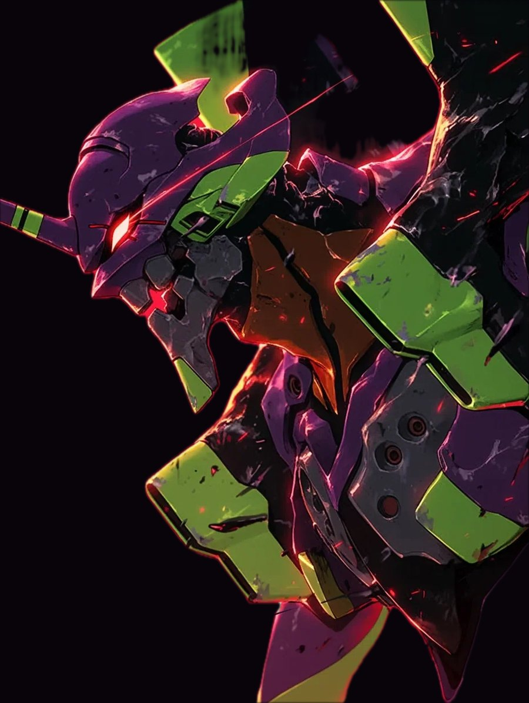

# EVA Launch Console Skin · 初号机启动控制台

把 **DeepSeek Harness Web GUI** 改成 EVA 启动控制台的皮肤插件（Cordis bundle，Host 提供余额/素材路由，Client 负责全部界面）。

- 包名：`dsh-eva-unit-01-skin`
- 当前版本：**v1.10.0（使徒剪影替换）**
- 形态：Client 侧皮肤插件 + 只读 Host 路由（余额、驾驶员素材）
- 适配：Harness Desktop / Web 客户端，深色与浅色两套宿主配色

## 开场：TV 风格「使徒、襲来」

页面加载后首先出现 TV 风格的标题卡：

- 大字 **使徒、襲来 / ANGEL ATTACK**、从项目所有者提供的参考图抠出的**翼状使徒剪影**（透明 PNG，保留红色 figure + 白色翼线）、红色地震波形、`TOKYO-3 / 緊急放送`、扫描线与时间码
- 点击「▶ 起動」后播放**原创**的使徒袭来 BGM（低音 E/F 半音固定音型、定音鼓、高频簇与远处警报）和标题动画；约 5 秒后进入驾驶员选择
- 首次点击同时解锁浏览器音频；若不点击则停留在标题卡，不会自动跳转
- **不是 TV 原片或原曲**：画面为新绘制的致敬元素，音乐为 WebAudio 实时合成的原创 cue；不复制任何官方画面/音轨



## 驾驶舱面板（v1.9.0）

聊天页左侧只保留**一个合并面板**，不再有左右两个 console 和重复的 HUD 读数：

- **顶部驾驶员信息**：立绘、姓名/机体编号、同步环、A10、LCL、VOICE
- **中部 EVA POWER / 状态**：余额映射电量（¥1≈1%）、10 段电池、余额金额、`15%` 阈值、MAGI / A.T. / UPLINK / MODE
- **底部驾驶员切换**：碇シンジ / 明日香 / 綾波レイ；点击名字后不会直接切换聊天页面，而是进入**已选择驾驶员的展示/加载页**：不再显示三张选择卡，改为显示该驾驶员的肖像、姓名、机体、语音档案和同步环 0→100% 装填动画；此时仍在搭乘前，需手动「接続開始」进入搭乘/启动流程
- **余额低于 ¥15 自动 BERSERK**，恢复后自动退出；手动关闭后不会在余额未恢复时反复强制开启
- **侧栏联动入口**：侧栏品牌行右侧空白位置增加 `⇄ 切换驾驶员 / PILOT` 文字按钮；面板默认隐藏，点击按钮才展开，再点一次或点面板 `×` 隐藏
- **非全屏可用**：窗口没有足够空白边距时，面板改为靠左浮层显示，确保非全屏状态也能看到完整驾驶员/电量面板
- **位置自适应**：实时测量聊天列与左右侧栏的边界；有边距时停在聊天窗口左侧空白区不遮挡消息，无边距时浮层显示并跟随侧栏/右侧栏/窗口缩放
- **可拖动**：拖动面板头部移动位置，位置持久化；双击头部复位
- **可收起**：`－` 收起为标题条；`×` 隐藏
- **高度贴合内容**：面板按内容自适应，不再出现整块空白

已删除的重复元素：对话头部 EVA 单位标签、Workbench 工作台条、输入舱右侧驾驶员/同步率条、canopy 遥测条、底部遥测中的 PILOT/SYNC/MAGI/POWER/A.T./LCL 读数；底部只保留单位、阶段、时钟、CYCLE 与暴走开关。

## 三名驾驶员 · 三台机体页面

启动前的**插入栓认证界面**选择驾驶员，进入对应机体页面：

| 驾驶员 | 机体 | 页面配色 | 音声 |
| --- | --- | --- | --- |
| 碇シンジ / SHINJI IKARI | **EVA-01 初号機** | 紫绿 NERV + 驾驶员蓝 | 模拟少年音 `BOYISH` |
| 明日香 / ASUKA LANGLEY | **EVA-02 二号機** | 红橙 + 深红黑 | 模拟高音 `BRIGHT` |
| 綾波レイ / REI AYANAMI | **EVA-00 零号機** | 白 / 冰蓝 + 冷灰 | 模拟冷淡音 `COLD` |

选择会持久化到 `localStorage: eva01.pilot`；工作台中的 `PILOT` 单元可随时切换驾驶员，主题、机体编号、驾驶卡图片与机体页面一起换。**点选驾驶员卡时会用该驾驶员的日语模拟音说自我介绍**（「こんにちは。碇シンジです…」等）。



### 插入栓与驾驶员选择动画

参考 `seaison/dsh-plugin-eva-theme` 的插入栓选人流程重做：

- 左侧大型 **插入栓**（倾斜 14°）与橙色等高线背景，筒体标识 `ENTRY PLUG / 挿入栓`、`EVA-01 · 初号機`
- 右侧三张驾驶员卡：驾驶员图像（插画裁切/线稿）+ 姓名 + 机体编号，选中卡描边、LED 与光晕点亮
- 切换驾驶员时：插入栓内立绘重播插入动画，同步环从 0→100% 充能，`SYNC` 数字实时跳动
- 进入页面时插入栓为空、**不显示驾驶员图片**、没有加载动画；**点选驾驶员卡后**才开始同步环 0→100% 的装填动画，装填完成后 `接続開始` 才可用
- 左侧插入栓只保留插入栓、同步环与状态读数，不显示任何驾驶员立绘；驾驶员图片只出现在右侧选择卡与机体页面
- 点选驾驶员卡时播放该驾驶员的日语自我介绍，装填动画开始
- **必须人工确认**：先点选驾驶员卡（选中后 `接続開始` 才可用），再点击 `接続開始` 或 `音声なしで起動`；没有倒计时、没有点击空白跳过、没有自动启动
- 每次打开/刷新页面都会先播放「使徒、襲来」开场并停留在选人界面，直到你手动确认
- 支持 `prefers-reduced-motion`（保留静态选人与声音）




## 启动序列（约 15.9s）

`システム起動 → パイロット認証 → パイロット搭乗 → プラグ挿入 → 神経接続 → シンクロ率 100% → 初号機 起動 → 発進`

- 每幕都有对应的机体配色、驾驶员立绘（EVA-01/02/00 专用）、日文分镜标签与系统字幕
- 插入栓场景的 **LCL 注液为橙黄色**（液面、气泡、注入条纹、容器边框与标签）
- 同步率环、装甲张开门、弹射轨道等分镜保留
- 跳过：右上 `SKIP`、`Esc`、`Space`、`Enter`；点画面其他位置不会误跳过
- 系统「减少动态效果」时改为 2.7s 静态三拍，并保留声音与字幕




## 配乐 / 音效 / 驾驶员语音（模拟音质）

- **原创配乐**：WebAudio 运行时合成 4 小节循环（Em(add9) → Cmaj7 → Am(add9) → B7sus4，52 BPM；pad + 低音脉冲 + 心跳 + 钟琴动机 + 噪声微光），启动阶段逐层加入，进入主界面后降为 idle 环境声。**没有音频文件、没有现成歌曲。**
- **原创音效**：`beep / alarm / clamp / lcl / sync / launch / typing / boot` 全部实时合成；使徒袭来开场的首次点击会启动原创 BGM。
- **驾驶员语音（模拟音质）**：三名驾驶员各有独立的系统 TTS 音色档案——Shinji `BOYISH`（少年感、偏慢、忧郁）、Asuka `BRIGHT`（高音、偏快）、Rei `COLD`（低音、慢速、平板）；说话时叠加低音量无线电底噪，模拟装甲通讯音质。**不是声优克隆，也不含动画原音**。
- **流程日语播报**：启动流程的每一幕（承認待ち / システム起動 / 搭乗 / プラグ接続 / 神経接続 / シンクロ上昇 / 起動 / 発進 / 接続完了 / 制御不能）会按当前驾驶员的模拟音用日语说出，并显示日/中字幕。
- **驾驶员自我介绍**：选人界面点选驾驶员时，会用该驾驶员的声音说「こんにちは。碇シンジです…」/「あたし、明日香…」/「……綾波レイ…」等日语介绍。
- **字幕**：启动分镜与暴走时右上角显示驾驶员通讯字幕（日语 + 中文），可叠在启动动画之上。
- **静音**：侧栏底部 `♪ 音声` 或底部遥测会统一开关；状态持久化 `eva01.sound`。

> 浏览器要求一次用户手势才能出声：点击插入栓界面、`▶ 起動` 或 `♪ 音声` 即可解锁。

## 工作台与余额

聊天下方新增 **NERV WORKBENCH** 扩展条，参考插件的桌面组件思路：

- **BALANCE**：通过 Host 只读路由 `/dsh-eva-unit-01/balance.json` 请求 DeepSeek 官方余额接口，60s 缓存；`↻` 手动刷新。凭据由 Host 的 credentials 服务读取，**密钥不会进入浏览器、日志或响应**；路由校验回环 Host、`Sec-Fetch-Site` 与 Origin。
- **PILOT**：点击循环切换驾驶员（同时换主题、机体页面，并用新驾驶员的声音自我介绍）。
- **CLOCK**：本地时针。
- **SCORE**：原创配乐播放/静音。
- **TPS**：装饰性实时波形。
- 余额不可用时显示 `NO KEY` / `OFFLINE` / `TIMEOUT`，不会拖垮页面。




## 主界面机甲化

- 底部全宽遥测条：`EVA-0x / 発進管制 / PILOT 0x / SYNC / MAGI / POWER / A.T. FIELD / LCL / 波形 / 时钟 / CYCLE`
- 左右边缘刻度导轨 + 竖排雕刻标签、输入舱切角与四角螺栓、消息板切角、侧栏警示条
- 顶部编号牌 `EVA-0x / PILOT 0x`，侧边栏品牌与 Hero 区跟随机体配色
- 侧边栏折叠态自动适配（隐藏与 macOS 窗口按钮冲突的编号牌、左上准星与左导轨）

## 失控模式（BERSERK / 暴走）

- **暴走立绘切入**：初号机 / 二号机暴走时，会展示你提供的暴走立绘（已抠图透明背景）约 4 秒；切入时缩放/故障闪烁，结束时淡出。零号机不展示此立绘。
- 图片由项目所有者提供并已完成背景抠除，归提供者所有。




底部遥测条最右 `⚠ 暴走` 或侧栏底部 `⚠ 暴走`：

- 全站血红/琥珀配色；`制御不能` 爆闪 + 驾驶员失控语音
- **一次性 5s 画面抖动**（±4px / 每 1.15s 剧烈抽动，`scale(1.02)` 防露白边），5s 后自动收住
- 6 条水平撕裂故障带 + 每 4.2s 整屏闪断 + 纵向滚动故障
- 遥测变为 `SYNC 412.0% / MAGI FAILED / POWER OVERLOAD / A.T. FIELD COLLAPSED / LCL LEAK`
- 配乐切到 128 BPM 失真层与警报；退出恢复当前驾驶员语音与曲目

## 安装

### Plugin Manager

1. Harness → 设置 → 插件 → 添加插件
2. 填仓库地址：`https://github.com/brunozhang416/dsh-eva-unit-01-skin`
3. 启用 **EVA 初号机启动皮肤**，刷新页面
4. 先进入插入栓选人界面；点击启动即带声音

### 本地目录

```bash
git clone https://github.com/brunozhang416/dsh-eva-unit-01-skin.git
```

设置 → 插件 → 添加插件 → 填克隆目录绝对路径 → 启用。

### 卸载

关闭插件即移除主题令牌、样式表、声音引擎、Host 路由与全部 Slot 贡献。

## 主页面切换驾驶员

左侧导航栏「新对话」按钮右上方空白区新增一个**切换箭头图标**（⇄，悬停显示「切换驾驶员 / SWITCH PILOT」）：点击即回到插入栓选人页面，重新选择驾驶员并播放对应自我介绍；侧栏折叠时自动隐藏，不会遮挡其他导航项。

## 控制

| 入口 | 作用 |
| --- | --- |
| 侧栏「切换驾驶员」图标 | 返回插入栓选人页（位于“新对话”右上方） |
| 插入栓界面卡片 | 选择驾驶员 / 机体页面 |
| 插入栓界面 `接続開始` | 带声音开始八幕启动 |
| 侧栏 `▶ 起動` | 用当前驾驶员重播启动 |
| 侧栏 `◈ HUD` | HUD 强度：完整 / 精简 / 关闭 |
| 侧栏 `◐ MODE` | 明暗切换 |
| 侧栏 `♪ 音声` | 配乐 / 音效 / 语音总开关 |
| 工作台 `PILOT` | 循环切换驾驶员 |
| 工作台 `BALANCE ↻` | 刷新账户余额 |
| 侧栏 / 遥测条 `⚠ 暴走` | 切换失控模式 |

状态键：`eva01.hud.fx`、`eva01.berserk`、`eva01.sound`、`eva01.gate`、`eva01.pilot`。

## 开发

```bash
node build.mjs --check   # 把 src/skin.css、art/*.svg、src/audio.js 内联进 client.js
```

| 路径 | 说明 |
| --- | --- |
| `src/client.template.js` | Client 半源码（React createElement，无 JSX） |
| `src/skin.css` | 全部样式：令牌、宿主皮肤、HUD、启动序列、插入栓选人、暴走、折叠适配 |
| `src/audio.js` | 原创 WebAudio 合成器：配乐、相位分层、8 种音效、驾驶员 TTS 队列与通讯底噪 |
| `src/audio-notes.md` | 音频引擎 API 与设计说明 |
| `index.js` | Host：余额路由 + 驾驶员素材静态路由（回环/同源校验） |
| `art/*.svg` | 原创矢量：机体头像 / 徽章 / 驾驶员线稿源 / AT 力场 |
| `assets/*.png` | 选人界面线稿与机体立绘（见 NOTICE） |
| `assets/entry-plug.svg` | 插入栓素材（见 NOTICE） |
| `assets/berserk-01.png` / `berserk-02.png` | 初号机/二号机暴走立绘（抠图，所有者提供） |
| `assets/avatar-shinji.png` / `portrait-shinji.png` | 项目所有者提供的碇真嗣插画裁切 |
| `assets/avatar-asuka.png` / `portrait-asuka.png` | 项目所有者提供的明日香插画裁切 |
| `assets/avatar-rei.png` / `portrait-rei.png` | 项目所有者提供的绫波丽插入栓插画裁切 |
| `client.js` | 构建产物 |

## 兼容性与边界

- 宿主类名轮换时使用 `[class*="_localName"]` 与稳定 `[data-slot]` / `role` / `aria-label` 锚点降级。
- 声音需要一次手势解锁；驾驶员语音依赖系统 `speechSynthesis`，不可用时自动静默，字幕照常显示。
- 余额需要 Host 凭据服务可用且已配置 `DEEPSEEK_API_KEY`；无网络/无密钥时显示状态码。
- 余额路由仅监听回环地址并校验同源与 `Sec-Fetch-Site`，只读、无写操作。

## 素材与授权

- 代码与原创矢量/音频/台词：MIT（见 `LICENSE`）。
- **插入栓 SVG** 来自 [`seaison/dsh-plugin-eva-theme`](https://github.com/seaison/dsh-plugin-eva-theme)，按其仓库说明其媒体素材不在 MIT 覆盖范围内；本仓库按用户要求引用并保留署名，权利归原作者。插入栓 SVG 做了 XML 合法性与内联样式修复。碇真嗣、明日香、碇真嗣、明日香、绫波丽图像均使用项目所有者提供的插画素材裁切，版权归提供者。见 [`NOTICE.md`](NOTICE.md)。
- 碇真嗣、明日香、碇真嗣、明日香、绫波丽图像均使用项目所有者提供的插画素材裁切与透明化处理，不复制官方原画。
- 不包含官方动画音轨、声优录音或官方美术素材；角色名与机体名为致敬性引用，本项目为非商业粉丝作品。

## License

[MIT](LICENSE) © 2026 brunozhang416
